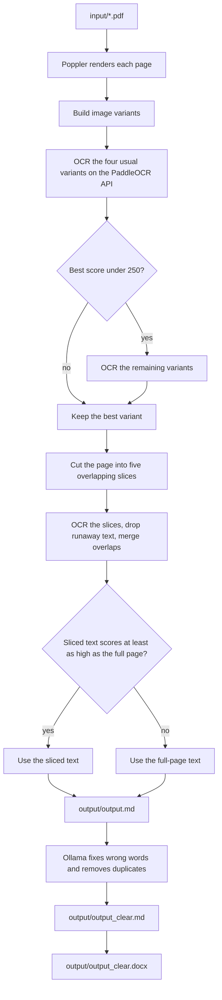

# OCR PDF Project

Batch OCR for scanned PDFs. `src/main.py` renders each page, sends it to a PaddleOCR HTTP API, and writes Markdown. An Ollama model then fixes wrong words and removes duplicate words and lines. The cleaned text is also written as a Word document.

## Flow



```text
OCR_D/
├── .env
├── requirements.txt
├── input/          # put PDFs here
├── output/         # output.md and output_clear.md
└── src/
    ├── api.py              # HTTP API: upload a scan, get Markdown back
    ├── main.py             # batch run over input/
    ├── ollama_correct.py
    ├── utils.py
    └── postprocess.py
```

## What you need

| Piece | Role |
|---|---|
| Python 3.11 or 3.12 | Runs the script. 3.14 works only with the newer Torch and SentencePiece builds below. |
| Poppler (`pdftoppm`, `pdfinfo`) | Renders PDF pages to images. |
| PaddleOCR API | Does the OCR. This repo does not run that model itself. |
| Ollama | Fixes wrong words and duplicate words in the OCR text. Must be running at `OLLAMA_HOST`. |

The OCR model is [PaddleOCR-VL-1.5](https://huggingface.co/PaddlePaddle/PaddleOCR-VL-1.5). It must already be served at `PADDLE_API_URL`. Pull the correction model on the Ollama host before the first run, for example `ollama pull qwen3`.

## CentOS system packages

Tested commands are for CentOS Stream 9, Rocky Linux 9, and AlmaLinux 9 (`dnf`). The host must reach the OCR API and the Ollama server in `OLLAMA_HOST`.

```bash
sudo dnf install -y python3.11 python3.11-pip python3.11-devel \
  gcc gcc-c++ make cmake pkgconf-pkg-config poppler-utils
```

`poppler-utils` supplies `pdftoppm` and `pdfinfo`. Confirm with:

```bash
which pdftoppm
```

That directory (usually `/usr/bin`) is the value of `POPPLER_PATH`.

Python packages from `requirements.txt`:

| Package | Used for |
|---|---|
| `pdf2image` | Calls Poppler to render pages |
| `requests` | Calls the OCR API |
| `python-dotenv` | Reads `.env` |
| `opencv-python-headless` | Page preprocessing |
| `transformers`, `sentencepiece`, `torch`, `ftfy` | Vietnamese text correction |
| `python-docx` | Writes `output/output_clear.docx` |
| `ollama` | Calls the Ollama chat API to correct the text |

`opencv-python-headless` does not need `mesa-libGL`.

### GPU

Install the NVIDIA driver first and check it:

```bash
nvidia-smi
```

The driver must be new enough for CUDA 13 (the 595 series is fine). The pip packages below ship the CUDA runtime, so a separate CUDA toolkit install is not required.

## Install

```bash
cd /opt/ocr
python3.11 -m venv .venv
source .venv/bin/activate
python -m pip install --upgrade pip
```

With an NVIDIA GPU:

```bash
pip install torch==2.9.0 --index-url https://download.pytorch.org/whl/cu130
grep -v -E '^(torch|sentencepiece)==' requirements.txt | pip install -r /dev/stdin
pip install 'sentencepiece>=0.2.1'
```

`torch==2.7.0` and `sentencepiece==0.2.0` in `requirements.txt` have no usable builds on newer Python. The commands above install a CUDA Torch and a SentencePiece wheel that do. A plain `pip install torch` from PyPI is CPU-only and will not see the GPU.

CPU only, if this machine has no GPU:

```bash
pip install torch==2.9.0 --index-url https://download.pytorch.org/whl/cpu
grep -v -E '^(torch|sentencepiece)==' requirements.txt | pip install -r /dev/stdin
pip install 'sentencepiece>=0.2.1'
```

## Configure

Create `.env` in the project root:

```text
POPPLER_PATH=/usr/bin
PADDLE_API_URL=http://<ocr-server>:8089/v1
MODEL_NAME=PaddleOCR-VL-1.5-0.9B
OLLAMA_HOST=http://127.0.0.1:11434
OLLAMA_MODEL=qwen3
```

| Variable | Meaning |
|---|---|
| `POPPLER_PATH` | Directory that contains `pdftoppm` |
| `PADDLE_API_URL` | OCR server base URL, including `/v1` |
| `MODEL_NAME` | Model name that server expects |
| `OLLAMA_HOST` | Ollama server URI |
| `OLLAMA_MODEL` | Ollama model used to fix wrong and duplicate words |

Optional, only read by the HTTP API:

| Variable | Default | Meaning |
|---|---|---|
| `API_HOST` | `0.0.0.0` | Address the server listens on. `127.0.0.1` keeps it reachable from this machine only. |
| `API_PORT` | `8000` | Port the server listens on |
| `API_KEY` | empty | When set, every `POST /ocr` must send header `X-API-Key` with this value |
| `MAX_UPLOAD_MB` | `50` | Largest accepted upload |
| `MAX_CONCURRENT_JOBS` | `1` | Files OCR'd at the same time. Extra requests wait their turn. |

## Run

1. Copy scanned PDFs into `input/`.
2. Activate the virtual environment: `source .venv/bin/activate`
3. Start the job:

```bash
python src/main.py
```

Results:

| File | Contents |
|---|---|
| `output/output.md` | Raw OCR, one section per page |
| `output/output_clear.md` | OCR text after Ollama fixes wrong words and removes duplicates |
| `output/output_clear.docx` | The cleaned text as a Word document |

Ollama must already be running and the model in `OLLAMA_MODEL` must be pulled. Each page is sent with `client.chat`. The model is asked to fix wrong words and drop repeated words, lines, and paragraphs, then return only the corrected text.

## HTTP API

Other systems can upload a scan and get the Markdown back, without touching `input/` or `output/`. Start the server from the project root:

```bash
.venv/bin/python src/api.py
```

It listens on `API_HOST` and `API_PORT` from `.env` (default `0.0.0.0:8000`). Change the port there and restart; no command change is needed. The examples below use port 8000.

Interactive docs are at `http://<server>:8000/docs`.

### `POST /ocr`

Upload one file as multipart field `file`. The type is detected from the content: a PDF (every page is OCR'd) or an image (PNG, JPG, TIFF including multi-page TIFF, BMP, WEBP). The response is the Markdown file itself, sent as a download named after the upload (`scan.pdf` becomes `scan.md`).

| Query parameter | Default | Meaning |
|---|---|---|
| `correct` | `true` | Run the Ollama correction. `false` returns raw OCR, which is faster. |

```bash
curl -F "file=@scan.pdf" http://<server>:8000/ocr -o scan.md
```

With an API key and without correction:

```bash
curl -H "X-API-Key: <key>" -F "file=@page.jpg" \
  "http://<server>:8000/ocr?correct=false" -o page.md
```

From Python:

```python
import requests

with open("scan.pdf", "rb") as f:
    r = requests.post(
        "http://<server>:8000/ocr",
        files={"file": ("scan.pdf", f, "application/pdf")},
        headers={"X-API-Key": "<key>"},
        timeout=1800,
    )
r.raise_for_status()
open("scan.md", "w", encoding="utf-8").write(r.text)
```

The request stays open until OCR finishes, roughly 30 to 60 seconds per page, so give clients a long timeout.

Response headers:

| Header | Meaning |
|---|---|
| `X-Page-Count` | Pages OCR'd |
| `X-OCR-Correction` | `applied`, `skipped` (`correct=false`), or `failed`. On `failed` the body is the raw OCR, so the work is not lost; check the server log for the Ollama error. |

Errors:

| Status | When |
|---|---|
| `400` | Empty upload |
| `401` | `API_KEY` is set and the header is missing or wrong |
| `413` | Larger than `MAX_UPLOAD_MB` |
| `415` | Not a PDF or a supported image |
| `422` | The file has no pages |

### `GET /health`

Returns `{"status": "ok"}`. Use it for load balancer or uptime checks.

## Deploy

A typical layout on the server:

```text
/opt/ocr/          # this repository
/opt/ocr/.venv/    # virtualenv created above
/opt/ocr/input/    # incoming PDFs
/opt/ocr/output/   # results
```

Run it as the deploy user, not root. `input/` and `output/` must be writable by that user. Outbound access is required to `PADDLE_API_URL` and `OLLAMA_HOST`.

A systemd oneshot, `/etc/systemd/system/ocr-pdf.service`:

```ini
[Unit]
Description=OCR scanned PDFs
After=network-online.target

[Service]
Type=oneshot
User=ocr
WorkingDirectory=/opt/ocr
ExecStart=/opt/ocr/.venv/bin/python src/main.py
```

Then:

```bash
sudo systemctl daemon-reload
sudo systemctl start ocr-pdf.service
sudo journalctl -u ocr-pdf.service -e
```

Drop new PDFs in `/opt/ocr/input/` and start the service again. Each run rewrites `output/output.md`, `output/output_clear.md`, and `output/output_clear.docx` from every PDF currently in `input/`.

### HTTP API as a service

`/etc/systemd/system/ocr-api.service`:

```ini
[Unit]
Description=OCR scan to Markdown API
After=network-online.target

[Service]
User=ocr
WorkingDirectory=/opt/ocr
EnvironmentFile=/opt/ocr/.env
ExecStart=/opt/ocr/.venv/bin/python src/api.py
Restart=on-failure

[Install]
WantedBy=multi-user.target
```

```bash
sudo systemctl daemon-reload
sudo systemctl enable --now ocr-api.service
sudo firewall-cmd --permanent --add-port=8000/tcp
sudo firewall-cmd --reload
```

If you change `API_PORT`, open that port in the firewall instead of 8000 and run `sudo systemctl restart ocr-api.service`.

Set `API_KEY` in `.env` before opening the port beyond your internal network. If a reverse proxy such as nginx sits in front, raise its body size and read timeout (for example `client_max_body_size 50m;` and `proxy_read_timeout 1800s;`), or long PDFs will be cut off.
